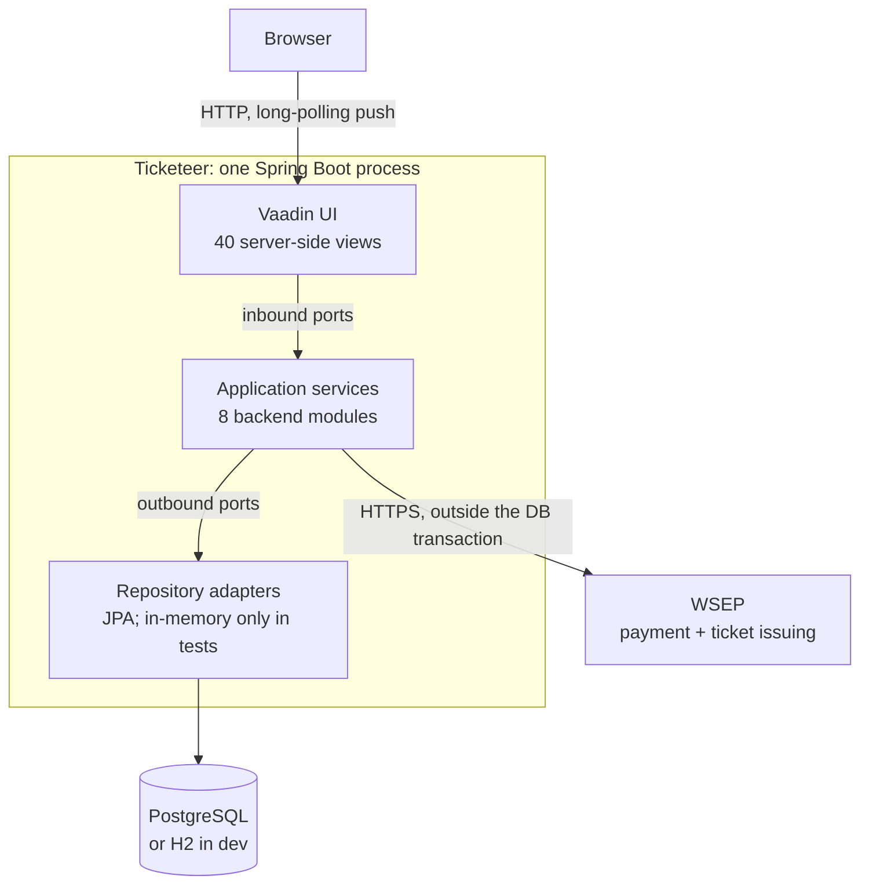
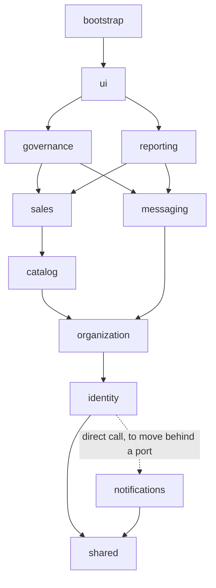

<div align="center">

# Ticketeer

**Event ticketing for production companies and their buyers: publish events with real seat
inventory, hold tickets for a fixed window, and check out all-or-nothing against external payment
and ticket-issuing services.**

[](https://github.com/NaimElijah/Ticketeer/actions/workflows/ci.yml)
[](https://github.com/NaimElijah/Ticketeer/security/code-scanning)
[](https://github.com/NaimElijah/Ticketeer/commits/dev)

[Requirements](docs/requirements/requirements.md) · [Module docs](docs/architecture/README.md) ·
[ADRs](docs/ADRs/) · [Demo data](SEED.md) · [Roadmap](https://github.com/NaimElijah/Ticketeer/milestones)

</div>

[What and why](#what-and-why) · [Features](#features) · [Architecture](#architecture) ·
[Tech stack](#tech-stack) · [Quick start](#quick-start) · [Configuration](#configuration) ·
[Development](#development) · [Testing](#testing) · [Operations](#deployment-and-operations) ·
[Design decisions](#design-decisions) · [Status](#status-and-limitations)



## What and why

Selling tickets is a concurrency problem with money attached: two buyers race for the last seat,
the payment service times out mid-checkout, or an event is cancelled after the sales are in.
Ticketeer lets production companies publish events with venue maps, seat inventory and purchase
policies. Guests and members hold tickets for a fixed window and buy them in one all-or-nothing
checkout. System admins bring the platform up, open and close the market, and watch it run. The
domain guarantees that no seat is sold twice, a failed payment buys nothing, and a cancelled event
refunds its buyers ([requirements](docs/requirements/requirements.md)).

It moves no real money: payments and ticket issuing go through WSEP, the external service the
course provides, until a Stripe test-mode adapter replaces it ([#98](https://github.com/NaimElijah/Ticketeer/issues/98)).

## Features

- **Run a production company.** Open one as its Founder, appoint co-owners and managers, who must
  accept, and give each manager any of five permissions, from `MANAGE_INVENTORY` to
  `RESPOND_TO_INQUIRIES`. The role tree is visible to the owners.
- **Publish events with real inventory.** Seated zones with rows and numbered seats, standing
  zones with a capacity, a venue map that shows free and taken places live, and purchase policies.
- **Browse and search as a guest or a member.** Search by name, artist, category or keyword, and
  filter by price, date, location and rating.
- **Hold, then buy.** Reserved tickets are locked for 10 minutes. Checkout charges, issues and
  confirms everything or nothing; a failure releases the tickets and refunds the charge.
- **Keep your cart across logins.** A member who logs back in before the hold expires gets the
  cart back with its remaining time.
- **Cancel an event and refund its buyers.** Refunds are tracked per receipt line, so a
  cancellation cut short by a payment outage resumes when the owner cancels again
  ([ADR-001](docs/ADRs/ADR-001-refund-state-per-receipt-line.md)).
- **Talk to the platform.** Send inquiries to companies and complaints to admins, and receive
  admin announcements and alerts. Alerts for offline members wait for their next login.
- **Operate it as an admin.** Open and close the market, answer complaints, and view global
  purchase history and live analytics. The platform verifies its own structural integrity before
  it initializes and again before the market opens.

## Architecture

A DDD + hexagonal modular monolith. Each top-level package under `com.ticketing.system` is a
Spring Modulith module. Contexts are meant to talk through ports (interfaces owned by one side)
and events. Some still reach into another context's repository ports, entities and services; #54
replaces those. The module graph is acyclic, and each module may depend only on the modules it
reaches by following the solid arrows below. The dashed arrow is one class pair, not a module edge.
The build fails if either stops being true.



An arrow means "depends on". An edge already implied by a longer path, such as `sales → identity`,
is left out, and so are the direct edges from `ui` and `bootstrap` to every backend module.
`governance` implements the sales-owned `MarketGate` port, which is how the market switch reaches
checkout without a cycle.

| Module | Responsibility |
|---|---|
| `shared` | Kernel: the exception hierarchy, `IRepository`, AOP aspects, `WsepHttpClient`, integration notices (`shared/event`) |
| `identity` | Users, sessions, admins, JWT authentication |
| `organization` | Production companies and the `CompanyAppointment` aggregate: roles and permissions |
| `catalog` | Events, venue maps, zones, seats, and inventory behind `InventoryCommandPort` |
| `sales` | Active orders, checkout, receipts, tickets, refunds, the WSEP adapters |
| `messaging` · `notifications` | Conversations and complaints · alert delivery from `shared/event` notices |
| `governance` · `reporting` | Platform lifecycle, market, analytics · the read side behind the dashboards |
| `ui` · `bootstrap` | The Vaadin views and presenters · the composition root, schedulers and seeding |

**One request, end to end: a member checks out.** `CheckoutPresenter` calls
`CheckoutService.checkoutMember`, which refuses at once if `MarketGate` reports the market closed.
It freezes the cart, then prices it and calls WSEP to charge and to issue the tickets, holding no
lock and no database transaction across either HTTP call. A single `TransactionTemplate` unit then
holds a shared lock on each event, so a cancel waits for the sale, re-validates the hold, writes the
tickets and the `OrderReceipt`, and confirms the seats RESERVED → SOLD through catalog's
`InventoryCommandPort` ([ADR-015](docs/ADRs/ADR-015-sales-hold-a-shared-lock-on-their-events.md)). If
that unit loses a concurrency race, for example to another sale in the same standing zone, it runs
again, up to three attempts in all. If it still fails, it rolls back, and the service returns the
seats to stock and refunds the charge. On success it publishes a `PurchaseCompletedNotice`, which `notifications`
turns into an alert after the purchase commits, on a background thread, so a slow or failing alert
never delays or fails the checkout ([ADR-004](docs/ADRs/ADR-004-no-outbox-for-notifications.md)).

**Every repository port has two adapters**, and one abstract contract test runs against both.
`JpaXxxRepository` serves every run; `MemoryXxxRepository` exists only for the in-memory test suite,
which activates `test` and `memory` together
([ADR-005](docs/ADRs/ADR-005-persistent-storage-by-default.md)). On JPA, concurrency is optimistic
(`@Version`), and an aspect re-types commit-time lock failures into domain exceptions.

**The platform has a lifecycle:** `UNINITIALIZED → READY → OPEN ↔ CLOSED`, held in
`SystemAdminService`. At boot, `PlatformInitializationRunner` reaches READY once the payment
gateway and ticket issuer answer and a System Admin exists; it creates that admin from
`PLATFORM_ADMIN_*` when there is none. `MarketOpener` then opens the market on every boot outside
the `test` profile, and `MarketSelfHealScheduler` keeps retrying while WSEP is down. A WSEP outage
is the only initialization failure the app boots through; a missing admin or persisted state that
breaks an invariant stops the boot ([ADR-003](docs/ADRs/ADR-003-fatal-and-self-healing-init-failures.md)).

Module canvases and C4 diagrams: [docs/architecture/](docs/architecture/README.md). Decisions:
[docs/ADRs/](docs/ADRs/). A full `architecture.md` is tracked in
[#43](https://github.com/NaimElijah/Ticketeer/issues/43).

## Tech stack

| Layer | Technology | Version | Why |
|---|---|---:|---|
| Language | Java | 21 | Records for the immutable DTOs and integration notices |
| Framework | Spring Boot | 3.5.16 | Transactions, profiles and AOP, with the domain kept free of Spring |
| UI | Vaadin Flow | 24.10.7 | Server-side Java views, so one language and one process from view to database |
| Modularity | Spring Modulith | 1.4.14 | Module model, verification and generated module docs |
| Architecture tests | ArchUnit | 1.4.2 | Fails the build on a layer violation or a module cycle |
| Persistence | Spring Data JPA on PostgreSQL, H2 | Boot-managed | One port per aggregate; the database is a configuration switch |
| Schema migrations | Flyway | Boot-managed (11.7.2) | Versioned SQL applied at startup; Hibernate only validates ([ADR-007](docs/ADRs/ADR-007-flyway-schema-migrations.md)) |
| Auth | jjwt + BCrypt | 0.13.0 | Signed session tokens and hashed passwords |
| Build | Maven wrapper | 3.9.16 | The pinned build tool ships in the repo |

## Quick start

**Prerequisites:** JDK 21. Maven ships with the repo through the wrapper, and the `dev` profile
needs no database server or Docker: it runs on in-memory H2.

```bash
git clone https://github.com/NaimElijah/Ticketeer.git && cd Ticketeer
./mvnw spring-boot:run "-Dspring-boot.run.profiles=dev"
```

Open <http://localhost:8080>. `/actuator/health` answers `{"status":"UP"}` once it is ready. The
first run also downloads the dependencies and builds the Vaadin frontend, so it is much slower
than later ones.

> [!NOTE]
> On Windows, `./mvnw` resolves to `mvnw.cmd`. Keep the quotes around every `-D…` argument:
> PowerShell 5.1 splits an unquoted `-Dspring-boot.run.profiles=dev` at the first dot.

The `dev` profile replays [`demo.scenario`](src/main/resources/scenarios/demo.scenario) on every
boot: 2 companies, 6 events in different states, 5 completed orders and a pending cart. Every
seeded member's password is `password123`:

| Log in as | To see |
|---|---|
| `alice` | A Founder's view: Live Nation Israel, its events, managers and sales |
| `bob` | A manager limited to `CONFIGURE_VENUE` and `VIEW_SALES` |
| `erin` | A buyer with a cart already holding two Coldplay tickets |
| `admin` / `admin` at `/admin/sign-in` | The admin dashboard, market control, analytics and complaints |

The full dataset and every persona: [SEED.md](SEED.md).

## Configuration

The runtime settings in `src/main/resources/application.yml` read environment variables with a
development default (`${ENV:default}`). The defaults are for local use only. Outside `dev`,
set these:

| Variable | Purpose | Default | Required |
|---|---|---|---|
| `SPRING_PROFILES_ACTIVE` | `supabase` for Supabase over SSL; plain PostgreSQL needs no profile | none: PostgreSQL through `DB_*` | No |
| `DB_HOST` · `DB_PORT` · `DB_NAME` | PostgreSQL location | `localhost` · `5432` · `ticketing` | Yes |
| `DB_USER` · `DB_PASSWORD` | PostgreSQL credentials | `postgres` · `postgres` | Yes |
| `JWT_SECRET` | Token signing key, 256 bits or more | a dev-only value | Yes, outside `dev` and `test`: the boot stops on the committed default |
| `PLATFORM_ADMIN_USERNAME` · `PLATFORM_ADMIN_PASSWORD` | The System Admin created at boot when none exists | `admin` · `admin` | Yes; outside `dev` and `test` the boot stops on the committed default password |
| `WSEP_BASE_URL` | The external payment and ticket-issuing service; must be an `https://` URL, or the boot stops | the course's WSEP host | No |

**Startup validates the initialization settings.** The `constants`, `session`, `auth.lockout`,
`wsep`, `platform.admin`, `platform.time-zone`, `seed`, `market`, `analytics`, `sweeper`,
`event-completion`, `notifications`, `identity`, `jwt`, `catalog.venue-limits` and `database` groups bind to validated records.
A value out of bounds, such as a zero hold, a negative TTL, a blank admin password, a JWT secret under 32 characters, an unknown
time zone, a malformed WSEP URL or a zero sweep delay, stops the boot with a report naming the
property ([ADR-003](docs/ADRs/ADR-003-fatal-and-self-healing-init-failures.md)). Outside `dev` and
`test`, a `JWT_SECRET` or `PLATFORM_ADMIN_PASSWORD` left at the default committed in
`application.yml` stops the boot too, naming the variable to set
([#34](https://github.com/NaimElijah/Ticketeer/issues/34)). A default admin already stored with the
committed password gets `PLATFORM_ADMIN_PASSWORD` instead at boot, and any other admin still on it
stops the boot ([ADR-014](docs/ADRs/ADR-014-committed-default-secrets-are-fatal-outside-dev-and-test.md)).
The datasource is not validated yet.
[`.env.example`](.env.example) lists the variables a deployment sets.

**Settings can come from a file instead of the environment.** Spring Boot layers an external
`application.yml` over the bundled defaults:

```bash
java -jar target/event-ticket-system-0.0.1-SNAPSHOT.jar --spring.config.additional-location=file:/etc/ticketeer/
java -jar target/event-ticket-system-0.0.1-SNAPSHOT.jar --spring.config.import=file:./ticketeer.yml
./mvnw spring-boot:run "-Dspring-boot.run.arguments=--spring.config.import=file:./ticketeer.yml"
```

`additional-location` reads `application.yml` (and `application-<profile>.yml`) from that folder;
`import` reads one named file. A key set in the file replaces the bundled entry, `${VAR:default}`
placeholder included. An environment variable still wins only when its name is the property's own
name in environment form, as with `WSEP_BASE_URL`, `SESSION_*`, `PLATFORM_ADMIN_*`, `JWT_SECRET` and
`SEED_*`. `TICKET_RESERVATION_DURATION`, `ORDER_EXPIRATION_DURATION`, `PLATFORM_TIME_ZONE`, `DB_*`
and `DB_POOL_SIZE` are read only through the bundled placeholder, so a file that sets their key
overrides them. Set each value in one place.

> [!NOTE]
> With no profile at all, the app runs on PostgreSQL through the `DB_*` variables. If it cannot
> reach the database, startup stops with an "APPLICATION FAILED TO START" report that names the
> datasource URL and the settings to check. It never falls back to in-memory storage
> ([ADR-005](docs/ADRs/ADR-005-persistent-storage-by-default.md)). For a local run without a
> database server, use `dev`.

<details>
<summary>Every other setting, and what each profile does</summary>

| Variable | Purpose | Default |
|---|---|---|
| `SESSION_MEMBER_TTL_MINUTES` | Absolute member-session lifetime | `1440` |
| `SESSION_GUEST_IDLE_TIMEOUT_MINUTES` | Guest-session lifetime, counted from its start; nothing extends it yet, and the UI replaces an expired one ([OQ-8](docs/requirements/requirements.md#open-questions)) | `30` |
| `AUTH_LOCKOUT_MAX_ATTEMPTS` · `AUTH_LOCKOUT_LOCK_MINUTES` | Login lockout: attempts allowed in a window of that many minutes from the first failure; `0` attempts disables it | `5` · `15` |
| `IDENTITY_RESERVED_USERNAMES` | Comma-separated usernames no member may register, ignoring case; `PLATFORM_ADMIN_USERNAME` is always reserved too | `admin,platform.admin` |
| `TICKET_RESERVATION_DURATION` | Ticket hold, in minutes | `10` |
| `ORDER_EXPIRATION_DURATION` | Read by no code yet (#166); the hold time is `TICKET_RESERVATION_DURATION` | `60` |
| `ANALYTICS_RATE_WINDOW_MINUTES` · `ANALYTICS_REFRESH_INTERVAL_MS` | Analytics window, at most `120` (`ISystemMetrics.MAX_WINDOW_MINUTES`, the longest window the metrics answer; a longer one stops the boot) · dashboard refresh (`0` stops it) | `5` · `5000` |
| `WSEP_REQUEST_TIMEOUT_SECONDS` | Timeout of each WSEP request | `20` (`8` under `dev`) |
| `WSEP_HANDSHAKE_ATTEMPTS` · `WSEP_HANDSHAKE_BACKOFF_MS` | Retries for the reachability handshake only | `3` · `1000` |
| `MARKET_SELF_HEAL_DELAY_MS` | How often a closed-by-outage market retries opening | `30000` |
| `SWEEPER_FIXED_DELAY_MS` | Pause between sweeps that release expired sessions and carts | `60000` |
| `EVENT_COMPLETION_FIXED_DELAY_MS` | Pause between sweeps that mark finished events completed | `60000` |
| `NOTIFICATIONS_POLL_DELAY_MS` | Pause between pushes of new notifications to connected users | `60000` |
| `CATALOG_VENUE_MAX_GRID_SIZE` · `CATALOG_VENUE_MAX_SEATS_PER_ZONE` · `CATALOG_VENUE_MAX_STANDING_CAPACITY` · `CATALOG_VENUE_MAX_SEATS_PER_MAP` | The largest venue map a producer may save: grid rows and columns · seats in one seated zone · places in one standing zone · seats on the whole map (standing places not counted) | `12` · `49500` · `1000000` · `100000` |
| `PLATFORM_TIME_ZONE` | IANA zone that new and seeded events default to, and that the UI shows recorded times and "today" in ([ADR-008](docs/ADRs/ADR-008-event-time-zones-and-one-clock.md)) | `Asia/Jerusalem` |
| `DB_POOL_SIZE` | Connection pool size under `supabase` | `5` |
| `DB_SOCKET_TIMEOUT` | How long a PostgreSQL statement may wait for an answer before it fails, so a hung database cannot hold pool connections. It bounds every statement: keep it above the slowest legitimate query, above `WSEP_REQUEST_TIMEOUT_SECONDS` (a refund holds its receipt's lock across the payment call, and a second refund waits for it), and above the longest migration statement | `30s` |
| `SEED_MODE` · `SEED_ASSUME_YES` · `SEED_SCENARIO` | Replay or wipe data at boot; see [SEED.md](SEED.md) | `off` · `false` · `classpath:scenarios/demo.scenario` |
| `SEED_FAIL_FAST` | A failing scenario step stops the boot | `true` (`false` under `dev`) |

| Profile | Effect |
|---|---|
| *(none)* | JPA repositories on PostgreSQL through `DB_*`, real WSEP, market opened at boot; needs `JWT_SECRET` and `PLATFORM_ADMIN_PASSWORD` set to non-default values |
| `dev` | JPA repositories on in-memory H2, empty every boot and built by the Flyway migrations; replays `demo.scenario`, adds the dev panel |
| `supabase` | JPA repositories on Supabase PostgreSQL over SSL; `DB_HOST`, `DB_USER` and `DB_PASSWORD` have no default; one app instance at a time, since ids come from per-instance counters (#108) |
| `test` | The test suite's profile: JPA repositories on H2, stub WSEP, no boot runners or schedulers |
| `memory` | Tests only, together with `test`: swaps in the in-memory repositories. Does nothing on its own |
| `production` · `no-vaadin` | Maven build profiles: bundle the frontend and leave the dev-only libraries (Vaadin's dev server, H2) out of the jar; Hilla is excluded in every build (ADR-013) · skip Vaadin's frontend step |

</details>

## Development

Work branches off `dev` as `feat/…`, `fix/…`, `docs/…`, `chore/…` or `refactor/…`, and merges back
through a pull request. A release is a separate promotion PR from `dev` to `main`. Commits follow
[Conventional Commits](https://www.conventionalcommits.org/) and end with a `Refs #N` line.

**Adding a feature end to end:**

1. Write a failing test against the domain in the owning context's `domain/`.
2. Expose it through an inbound port in `application/port/in` and its `@Transactional` service in
   `application/service`.
3. If it needs storage, extend the outbound port in `application/port/out`. Implement it in
   both adapters under `adapter/out/persistence`, and add the behaviour to that port's contract
   test. If an `@Entity` changes, add the next `V<n>__<description>.sql` to
   `src/main/resources/db/migration`, in SQL that both PostgreSQL and H2 accept. Never edit one that
   has already run ([ADR-007](docs/ADRs/ADR-007-flyway-schema-migrations.md)). A new foreign key, or
   a column a query starts filtering on, needs its index in the same migration: PostgreSQL does not
   index foreign keys on its own. `SchemaMigrationIT` fails for a foreign key without an index; add a
   newly filtered column to its list of queried columns.
4. Add a presenter in `ui/presenters` and a thin `@Route` view in `ui/views`.

`HexagonalRulesTest` fails the build if a dependency points the wrong way.

Code and Javadoc carry requirement IDs (`UC-10`, `II.2.8`, `SLR.1`). They are defined in
[requirements.md](docs/requirements/requirements.md), which also names the class and test that
enforce each requirement. Preserve them when editing.

To boot into a different state, point `seed.scenario` at your own `.scenario` file; the format is
in [SEED.md](SEED.md#scenario-file-format):

```bash
./mvnw spring-boot:run "-Dspring-boot.run.profiles=dev" "-Dspring-boot.run.arguments=--seed.scenario=file:/abs/path/your.scenario"
```

## Testing

About 2,100 test methods, organised by what they boot:

| Layer | Covers | Boots |
|---|---|---|
| `unit/` · `ui/` | Domain rules, services and presenters with mocked ports, both adapters of every repository port | Nothing, or `@DataJpaTest` on H2 for the JPA contract tests |
| `acceptance/` | Use cases end to end through the services | Spring under `test` + `memory`: in-memory repositories and stub WSEP |
| `integration/` · `concurrency/` | JPA persistence, and concurrent races for seats, checkouts, cancellations and refunds | Spring under `test`: JPA repositories on H2; each `concurrency/` suite, and the checkout, cancellation and first-reservation races, also run on PostgreSQL as `Postgres…IT` |
| `architecture/` | `HexagonalRulesTest` (ArchUnit), `ModularityTests` (Spring Modulith) and `RepositoryAdapterProfileTest` (which adapter each profile set selects) | Nothing |
| `*IT` classes | Every JPA repository contract suite on the production database (`Postgres…IT`), the migrations on a clean database, with an index on every foreign key and listed queried column (`SchemaMigrationIT`), the concurrency suites and the checkout, cancellation and first-reservation races (`Postgres…IT` in `concurrency/` and `integration/`), and recovery from a database outage (`DbOutageRecoveryIT`) | A PostgreSQL container per class (Testcontainers); run by failsafe in `verify`, never by `test` |

```bash
./mvnw -Pno-vaadin test "-Dtest=ReservationServiceTest"                # one class
./mvnw -Pno-vaadin test "-Dtest=*UserRepositoryContractTest"           # both adapters of one port
./mvnw -Pno-vaadin test "-Dtest=HexagonalRulesTest,ModularityTests"    # the architecture gates
./mvnw -Pno-vaadin test-compile failsafe:integration-test failsafe:verify "-Dit.test=DbOutageRecoveryIT"   # one *IT, needs Docker
./mvnw verify                                                          # everything CI runs; needs Docker
```

`-Pno-vaadin` skips Vaadin's frontend preparation, which the tests don't need. Use it for tests only,
because the app then serves no views.

**What gates a merge:** pull requests into `main` and `dev` need the CI check (`mvn -B verify` on
Temurin 21, with the JVM in UTC) and CodeQL to pass. A second job, "Test in Asia/Jerusalem", runs
the same suite with the JVM at UTC+2/+3, so code that depends on the server's zone fails there
([ADR-008](docs/ADRs/ADR-008-event-time-zones-and-one-clock.md)); it does not gate a merge until the
branch ruleset lists it. A third, "Production artifact", packages with `-Pproduction`, fails if
the jar carries H2 or Vaadin's dev tooling ([#79](https://github.com/NaimElijah/Ticketeer/issues/79))
or Hilla ([ADR-013](docs/ADRs/ADR-013-hilla-excluded-from-the-vaadin-starter.md)),
and boots the jar against PostgreSQL; it does not gate a merge yet either. "Dependency review"
fails a pull request that adds or upgrades to a dependency with a known high or critical
advisory, and Dependabot proposes updates weekly once its configuration is on `main`
([ADR-010](docs/ADRs/ADR-010-dependency-review-as-the-vulnerability-gate.md)); the review does not
gate a merge yet ([#200](https://github.com/NaimElijah/Ticketeer/issues/200)). Coverage is not
measured yet, and CI calls `mvn`, not the wrapper
([#45](https://github.com/NaimElijah/Ticketeer/issues/45)). There is no formatter or linter
([#46](https://github.com/NaimElijah/Ticketeer/issues/46)). The `*IT` classes start a throwaway
PostgreSQL container, so `verify` needs Docker, as the CI runner has; `-DskipITs` skips them
([ADR-006](docs/ADRs/ADR-006-postgres-integration-tests-with-testcontainers.md)).

## Deployment and operations

**Not deployed.** The `supabase` profile connects to a Supabase PostgreSQL database over SSL, and
AWS delivery is planned in milestone M5. `./mvnw -Pproduction package` builds the runnable jar
with the minified frontend, and without the dev-only libraries: Vaadin's dev server and H2.

| Concern | Today |
|---|---|
| Health | `GET /actuator/health` and `/actuator/info`; no separate readiness probe |
| Schema | Flyway applies `src/main/resources/db/migration` at startup, then Hibernate validates its mapping against it ([ADR-007](docs/ADRs/ADR-007-flyway-schema-migrations.md)). A database that `ddl-auto: update` built before this has no migration history and refuses to boot; drop and recreate its `public` schema once, or see the ADR to keep its data |
| Logs | Plain text to the console and `logs/event-ticket-system.log`, rolled daily. No JSON or correlation id ([#30](https://github.com/NaimElijah/Ticketeer/issues/30)) |
| Metrics and traces | Not exported yet ([#37](https://github.com/NaimElijah/Ticketeer/issues/37)) |

## Project structure

```text
src/main/java/com/ticketing/system/
  shared/              Kernel shared by every module
  identity/ … sales/   The bounded contexts from the module table, each one
                       domain/ · application/{port/in, port/out, service} · adapter/out/
  governance/          Platform lifecycle, market state, analytics
  reporting/           Read models for the dashboards and purchase history
  ui/                  Vaadin views, presenters, components, session state, route guard
  bootstrap/           Boot runners, schedulers, the .scenario seeding engine
src/main/resources/    application*.yml, logback-spring.xml, scenarios/
src/test/java/…        unit/ · ui/ · acceptance/ · integration/ · concurrency/ · architecture/
docs/                  requirements/ · architecture/ · ADRs/
```

## Design decisions

**Refund state per receipt line** ([ADR-001](docs/ADRs/ADR-001-refund-state-per-receipt-line.md)).
An order-level refunded flag could not say which event's lines were refunded, or resume a
cancellation cut short by a gateway failure. Each line now moves `NONE → PENDING → REFUNDED`, claimed
and recorded in short transactions around the gateway call. Cost: WSEP can only reverse a whole
charge, so refunding one event of a multi-event order over-refunds until Stripe replaces it.

**External calls outside the database transaction** (no ADR yet; tracked in
[#44](https://github.com/NaimElijah/Ticketeer/issues/44)). Checkout and event-cancellation refunds
call WSEP with no transaction and no connection held, then commit in short transactions. A slow
gateway therefore cannot exhaust the connection pool or hold row locks. Cost: a failure after the
charge needs an explicit compensating refund, and checkout idempotency is an in-memory cache that a
restart loses ([#25](https://github.com/NaimElijah/Ticketeer/issues/25)).

**Persistent storage by default; in-memory adapters only for tests**
([ADR-005](docs/ADRs/ADR-005-persistent-storage-by-default.md)). V3 requires that state survives a
restart and that switching databases is a configuration change only (SLR.7). Every run uses the JPA
adapters, so a forgotten profile can no longer lose data; the in-memory adapters keep the acceptance
suite fast and independent of a schema. Cost: every port is implemented twice, so each one carries a
shared contract test to stop the two from drifting.

**Flyway owns the schema; Hibernate only validates**
([ADR-007](docs/ADRs/ADR-007-flyway-schema-migrations.md)). `ddl-auto: update` only ever added
columns, so a type change or a data move could not ship. The same SQL migrations now build the
schema on PostgreSQL and on H2, in dev and in every test, and a mapped table or column that no
migration created fails the boot. Cost: every entity change needs a migration in SQL both
databases accept, and `validate` does not check length, nullability or constraints, so review must.

**Open Modulith modules, with ArchUnit as the boundary gate**
([ADR-011](docs/ADRs/ADR-011-archunit-module-map-as-the-boundary-gate.md)). The code began as a
layered monolith whose contexts still share services and domain types, so closing the modules to
named-interface ports is a larger follow-on. Cost: module boundaries are enforced as a fixed
module map (every allowed dependency listed, the graph acyclic) and layering rules, not as
type-level encapsulation, and the map and these docs are kept in step by hand.

## Status and limitations

**Pre-production.** The course versions V0–V3 are delivered, and
[requirements.md](docs/requirements/requirements.md) gives each requirement a status (Built,
Partial, Deferred, …) and names the class and test that enforce it. The road to a production
launch is on the
[milestones](https://github.com/NaimElijah/Ticketeer/milestones), among them correctness
close-out, production readiness, the engineering baseline, AWS delivery and go-live.

Known limitations:

- An admin's market close, checkout idempotency and login lockouts live in memory, so a restart
  forgets them ([#24](https://github.com/NaimElijah/Ticketeer/issues/24),
  [#25](https://github.com/NaimElijah/Ticketeer/issues/25),
  [#39](https://github.com/NaimElijah/Ticketeer/issues/39)).
- The datasource settings are not validated at boot, and with no profile they fall back to the
  committed `postgres`/`postgres` credentials.
- Money is a `double`, not integer minor units with a currency
  ([#73](https://github.com/NaimElijah/Ticketeer/issues/73)).
- Alerts arrive by polling, not push ([#61](https://github.com/NaimElijah/Ticketeer/issues/61)).
- Spring Boot 3.5 and Vaadin 24 are out of free support. The last free releases are pinned, with
  patched library versions on top, and two critical `spring-webmvc` advisories in features the app
  doesn't use are accepted ([ADR-009](docs/ADRs/ADR-009-direct-dependency-inventory.md),
  [#199](https://github.com/NaimElijah/Ticketeer/issues/199)).
- Nothing yet watches the merged dependency tree for new advisories: the dependency review sees
  only what a pull request changes, and Dependabot alerts are off
  ([#202](https://github.com/NaimElijah/Ticketeer/issues/202)).

The full status of every requirement, with the issue for each gap, is in
[requirements.md](docs/requirements/requirements.md).

---

## Licence and acknowledgements

Copyright (c) 2026 Naim Elijah. All rights reserved: no part of this project may be used,
copied, modified or distributed without written permission. The code inherited from
event-ticket-system stays under its MIT License, which [LICENSE](LICENSE) reproduces. Why:
[ADR-002](docs/ADRs/ADR-002-all-rights-reserved-licence.md).

Ticketeer continues [event-ticket-system](https://github.com/AdamSimkinbgu/event-ticket-system),
built by me and my collaborators as the Software Engineering Workshop project at Ben-Gurion
University. Its history up to July 2026 is imported from there.
